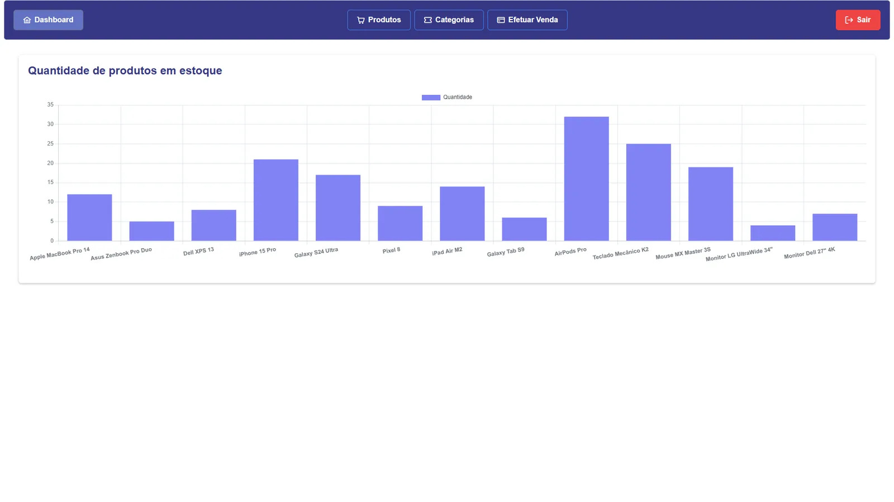
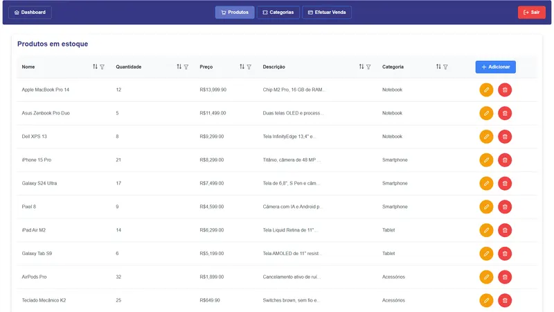
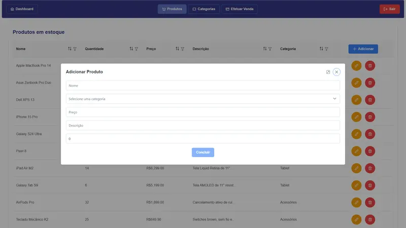
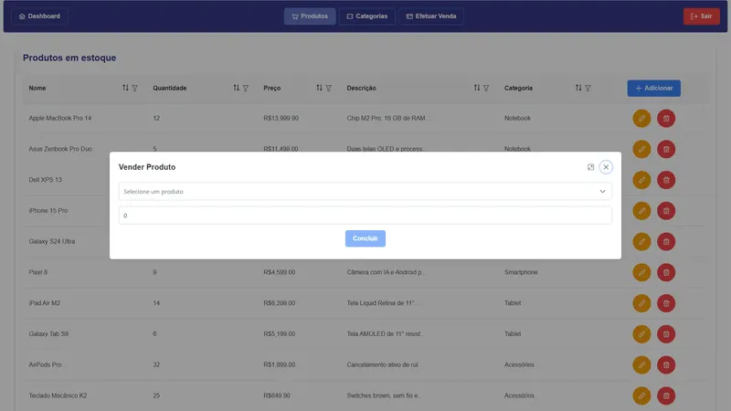

# Controle de Estoque e Vendas — Front-end em Angular

Front-end em Angular com PrimeNG: dashboard de estoque, produtos, categorias e vendas.

<p align="center">
  
</p>

---

## Sumário

- [Visão geral](#visão-geral)
- [Telas](#telas)
- [Stack e versões](#stack-e-versões)
- [Estrutura do projeto](#estrutura-do-projeto)
- [Primeiros passos](#primeiros-passos)
- [Configuração](#configuração)
- [Scripts](#scripts)
- [Projetos relacionados](#projetos-relacionados)
- [Autor](#autor)

---

## Visão geral

Versão em Angular do front-end do sistema de controle de estoque. Tem login com token em cookie, dashboard com gráfico da quantidade de produtos em estoque (Chart.js), tabelas de produtos e categorias com ordenação e filtros, formulários em diálogo para cadastrar e editar e a tela de venda de produtos. Organizado em módulos com lazy loading e guard de autenticação.

Principais funcionalidades:

- Módulos com lazy loading e guard de rota
- Componentes PrimeNG (tabelas, diálogos, toasts)
- Dashboard com Chart.js
- Formulários reativos
- Comunicação entre componentes com eventos e RxJS

Concluído em 08/2025.

---

## Telas

Todas as telas usam dados fictícios.

<table>
  <tr>
    <td width="50%"><br><sub>Front em Angular: tabela de produtos com ordenação e filtros</sub></td>
    <td width="50%"><br><sub>Front em Angular: cadastro de produto</sub></td>
  </tr>
  <tr>
    <td width="50%"><br><sub>Front em Angular: venda de produto</sub></td>
  </tr>
</table>

---

## Stack e versões

| Categoria | Tecnologia | Versão |
| --- | --- | --- |
| Linguagem | TypeScript | 4.9 |
| Framework | Angular | 15.2 |
| Build | Angular CLI | 15.2 |
| Estilo | PrimeFlex | 3.3 |
| Componentes | PrimeNG | 15.4 |
| Reatividade | RxJS | 7.8 |
| Gráficos | Chart.js | 4.4 |
| Testes | Jasmine + Karma | 4.5 / 6.4 |
| Qualidade | Prettier | 3.3 |

As versões exatas estão no `package.json`.

---

## Estrutura do projeto

```
src/
  app/
    guards/
    models/
    modules/
    services/
    shared/
    app-routing.module.ts
    app.component.html
    app.component.scss
    app.component.spec.ts
    app.component.ts
    app.module.ts
  assets/
    sean-pollock-PhYq704ffdA-unsplash.jpg
  environments/
    environment.prod.ts
    environment.ts
  favicon.ico
  index.html
  main.ts
  styles.scss
```

---

## Primeiros passos

### Pré-requisitos

- Node.js 16 ou mais recente (o Angular 15 pode avisar em versões novas do Node, mas roda)
- npm

### Instalação

```bash
git clone https://github.com/marcospsdev/Inventory-Control-in-Angular.git
cd Inventory-Control-in-Angular
npm install
npm start                 # http://localhost:4200
```

---

## Configuração

A URL da API fica em `src/environments/environment.ts` (`API_URL`, padrão `http://localhost:3333`). Este front foi feito para uma versão anterior da API.

---

## Scripts

| Comando | Descrição |
| --- | --- |
| `npm start` | Servidor de desenvolvimento em http://localhost:4200 |
| `npm run build` | Build de produção em `dist/` |
| `npm run watch` | Build em modo watch |
| `npm test` | Testes unitários |

---

## Projetos relacionados

- [Stock-Control-API-in-Node.js](https://github.com/marcospsdev/Stock-Control-API-in-Node.js): API REST em Node.js
- [Inventory-Control-in-React](https://github.com/marcospsdev/Inventory-Control-in-React): front-end em React
- [Inventory-Control-in-Angular](https://github.com/marcospsdev/Inventory-Control-in-Angular): front-end em Angular

---

## Autor

**Marcos Paulo** · Desenvolvedor Full-Stack

- LinkedIn: [in/marcospsdev](https://www.linkedin.com/in/marcospsdev)
- GitHub: [@marcospsdev](https://github.com/marcospsdev)
